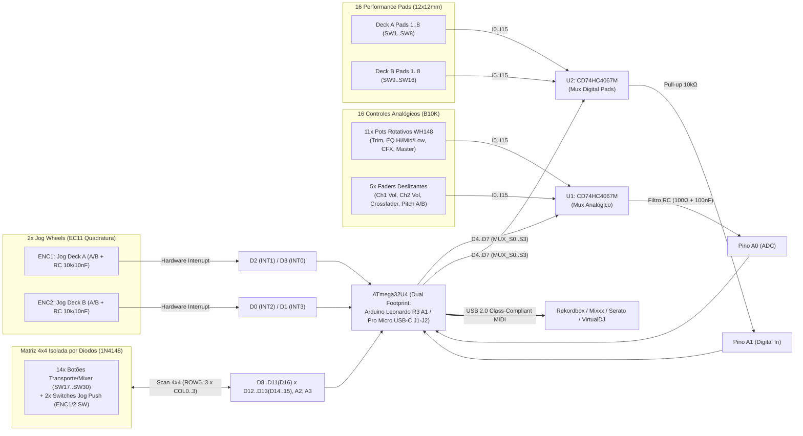

# Pioneer DDJ-FLX4 Inspired Open-Source 2-Deck USB-MIDI DJ Controller

Complete hardware (KiCad 9.0 4-Layer Mixed-Signal PCB + Schematic + Gerbers), mechanical enclosure (FreeCAD 1.0 ISO-10303 STEP + 3D-Printable STL models + Parametric OpenSCAD), and low-latency native USB-MIDI firmware (`ATmega32U4`) inspired by the **Pioneer DDJ-FLX4**.

---

## 1. Visual Previews (3D Raytraced PCB & 3D-Printable CAD Chassis)

### KiCad 9.0 3D Raytraced PCB (`340 x 220 mm`, 4-Layer Mixed-Signal FR4)


### FreeCAD 1.0 3D-Printable Enclosure Assembly (`350 x 230 x 38 mm`)


---

## 2. System Architecture & Multiplexing Topology

To achieve **zero-latency scratch/nudge response** on both Jog Wheels while polling **16 analog pots/faders** and **32 digital tactile switches** using a single **ATmega32U4** (`Arduino Leonardo R3` or `Arduino Pro Micro USB-C` wired in parallel on the PCB), the system uses:

1. **Hardware External Interrupts (`INT0..INT3` on `D0..D3`)** dedicated exclusively to the two `EC11` quadrature Jog Wheel encoders (`ENC1`, `ENC2`) with $10\text{ k}\Omega + 10\text{ nF}$ hardware RC debounce filters ($\tau = 100\ \mu\text{s}$).
2. **Dual 16-Channel CMOS Multiplexers (`U1` & `U2` = `CD74HC4067M`)** sharing a 4-bit address bus (`MUX_S0..S3` on `D4..D7`):
   - `U1` (`MUX1_COM -> R1 100Ω + C3 100nF -> A0`) scans all **16 analog controls** (`11x WH148 B10K` rotary pots + `5x B10K` linear slide faders).
   - `U2` (`MUX2_COM + R2 10kΩ pull-up -> A1`) scans all **16 Performance Pads** (`8x Deck A` + `8x Deck B`).
3. **4x4 Diode-Isolated Switch Matrix (`ROW0..3` $\times$ `COL0..3` with `16x 1N4148` diodes `D1..D16`)** scanning the **14 Transport & Mixer buttons** (`PLAY`, `CUE`, `SYNC`, `LOOP`, `LOAD`, `PFL CUE`, `SMART CFX`, `BEAT FX`) plus the **2 Jog Wheel push switches** (`ENC1_SW`, `ENC2_SW`) with zero ghosting under simultaneous multi-button chords.



---

## 3. Bill of Materials (BOM) — Synchronized with AliExpress Purchases

| Designator | Qty | Component & Spec | Footprint (KiCad 9.0) | AliExpress Order Reference |
| :--- | :---: | :--- | :--- | :--- |
| `A1` *(or `J1/J2`)* | 1 | **Arduino Leonardo R3** (`ATmega32U4`) **OR** **Arduino Pro Micro USB-C** (`ATmega32U4 5V 16MHz`) | `Module:Arduino_UNO_R3` + `PinHeader_1x12_P2.54mm_Vertical` (x2) | `8206118034152611` / `8206118034192611` |
| `U1`, `U2` | 2 | **CD74HC4067M** 16-Channel CMOS Multiplexer | `Package_SO:SOIC-24W_7.5x15.4mm_P1.27mm` | Existing stock / Schematic |
| `RV1..RV10`, `RV16` | 11 | **WH148 B10K ($10\text{ k}\Omega$ Linear)** Single-Gang Rotary Potentiometer + Knobs | `Potentiometer_THT:Potentiometer_Alps_RK09K_Single_Vertical` | `8206118034272611` |
| `RV11..RV15` | 5 | **B10K ($10\text{ k}\Omega$ Linear)** 45mm Slide Fader Potentiometer + ABS Fader Caps | `Potentiometer_THT:Potentiometer_Bourns_PTA4543_Single_Slide` | `8206118034212611` (Caps) |
| `SW1..SW30` | 30 | **G82 $12\times 12\times 5\text{ mm}$** 4-Pin Tactile Momentary Push Switch | `Button_Switch_THT:SW_PUSH-12mm` | `8206118034252611` (30 pcs lot) |
| `ENC1`, `ENC2` | 2 | **EC11** 360° Rotary Quadrature Encoder with Push Switch | `Rotary_Encoder:RotaryEncoder_Alps_EC11E-Switch_Vertical_H20mm` | `8206118034172611` (2 pcs lot) |
| `D1..D16` | 16 | **1N4148** High-Speed Switching Diode (DO-35) for 4x4 Matrix Anti-Ghosting | `Diode_THT:D_DO-35_SOD27_P7.62mm_Horizontal` | Starter Kit / Standard THT |
| `D17..D19` | 3 | **5mm Diffused LED** (Power, Deck A Active, Deck B Active) | `LED_THT:LED_D5.0mm` | `8206118034232611` (13-in-1 Kit) |
| `R1..R13` | 13 | Axial THT Resistors (`1x 100Ω`, `9x 10kΩ`, `3x 330Ω` 1/4W) | `Resistor_THT:R_Axial_DIN0207_L6.3mm_D2.5mm_P7.62mm_Horizontal` | `8206118034232611` (13-in-1 Kit) |
| `C1..C7` | 7 | Ceramic Disc Capacitors (`3x 100nF` decoupling/ADC, `4x 10nF` encoder RC) | `Capacitor_THT:C_Disc_D5.0mm_W2.5mm_P5.00mm` | Standard THT |
| `H1..H8` | 8 | **M3 $\times$ 12mm Screws** + M3 Standoffs / Threaded Inserts | `MountingHole:MountingHole_3.2mm_M3_Pad` | Mechanical Hardware |

---

## 4. Repository Structure

```text
Dj-controller/
├── hardware/
│   ├── ddj_flx4_controller.kicad_pro   # KiCad 9.0 Project File
│   ├── ddj_flx4_controller.kicad_sch   # Complete Schematic (102 symbols, 0 ERC violations)
│   ├── ddj_flx4_controller.kicad_pcb   # Routed 4-Layer 340x220mm PCB
│   ├── build_schematic.py              # Deterministic KiCad 9.0 Schematic Generator
│   ├── build_pcb.py                    # Deterministic pcbnew Placement & A* Router
│   ├── bom.csv                         # Complete Bill of Materials exported via kicad-cli
│   ├── erc_report.json                 # Verified 0-violation ERC Report
│   ├── drc_report.json                 # DRC Verification Report
│   └── gerbers/                        # Ready-to-fabricate Gerber & Excellon Drill files
├── cad/
│   ├── ddj_flx4_enclosure.scad         # Parametric OpenSCAD 3D Console Source
│   ├── build_cad.py                    # FreeCAD 1.0 OpenCASCADE STEP/STL Solid Compiler
│   ├── render_cad_views.py             # 3D Isometric STL Mesh Renderer
│   ├── step/                           # ISO 10303-21 STEP Assemblies & Parts
│   │   ├── ddj_flx4_full_assembly.step
│   │   ├── ddj_flx4_top_faceplate.step
│   │   ├── ddj_flx4_bottom_chassis.step
│   │   ├── ddj_flx4_jog_wheel.step
│   │   └── ddj_flx4_pad_keycap.step
│   └── stl/                            # 3D-Printable STL Meshes (Unibody + Split 220x220mm)
│       ├── ddj_flx4_full_assembly.stl
│       ├── ddj_flx4_top_faceplate.stl
│       ├── ddj_flx4_top_left_deckA.stl
│       ├── ddj_flx4_top_center_mixer.stl
│       ├── ddj_flx4_top_right_deckB.stl
│       ├── ddj_flx4_bottom_chassis.stl
│       ├── ddj_flx4_bottom_left_deckA.stl
│       ├── ddj_flx4_bottom_center_mixer.stl
│       ├── ddj_flx4_bottom_right_deckB.stl
│       ├── ddj_flx4_jog_wheel.stl
│       └── ddj_flx4_pad_keycap.stl
├── firmware/
│   ├── ddj_flx4_midi/
│   │   └── ddj_flx4_midi.ino           # Native ATmega32U4 USB-MIDI Firmware (MIDIUSB)
│   └── DDJ_FLX4_Arduino_MIDI.midi.xml  # Mixxx 2.4+ Controller Mapping Preset
├── docs/
│   ├── ddj_flx4_schematic.pdf          # Vector PDF Schematic
│   ├── ddj_flx4_controller.svg         # Vector SVG Schematic
│   └── ddj_flx4_pcb.svg                # Vector SVG PCB Layout
└── renders/
    ├── pcb_3d_top.png                  # KiCad 9.0 Raytraced 3D Top View
    ├── pcb_3d_iso.png                  # KiCad 9.0 Raytraced 3D Isometric View
    └── cad_isometric_render.png        # FreeCAD 3D Enclosure Render
```

---

## 5. 3D Printing & Assembly Instructions

1. **For Standard $220 \times 220\text{ mm}$ Printers (Ender 3 / Prusa MK4 / Bambu A1 Mini & A1):**
   - Print the **3 modular Top Faceplate sections**: `ddj_flx4_top_left_deckA.stl` ($121\times 230\text{ mm}$), `ddj_flx4_top_center_mixer.stl` ($108\times 230\text{ mm}$), and `ddj_flx4_top_right_deckB.stl` ($121\times 230\text{ mm}$).
   - Print the **3 modular Bottom Chassis sections**: `ddj_flx4_bottom_left_deckA.stl`, `ddj_flx4_bottom_center_mixer.stl`, and `ddj_flx4_bottom_right_deckB.stl`.
   - The seam ribs at $X = 116.0\text{ mm}$ and $X = 224.0\text{ mm}$ align directly over the central `M3` PCB mounting pillars (`H2`, `H3`, `H6`, `H7`), locking the PCB and chassis into a rigid structural sandwich with `8x M3x12mm` countersunk screws.
2. **Jog Wheels & Button Keycaps:**
   - Print `2x ddj_flx4_jog_wheel.stl` ($84\text{ mm}$ diameter, $0.16\text{ mm}$ layer height, $20\%$ gyroid infill) — press-fits directly onto the $6.0\text{ mm}$ knurled shaft of the `EC11` rotary encoders (`ENC1`, `ENC2`).
   - Print `30x ddj_flx4_pad_keycap.stl` (TPU 95A or PLA/PETG) — captured from below by the $14.2\times 14.2\text{ mm}$ retention flange before bolting the PCB to the `14.0 mm` internal standoffs.
