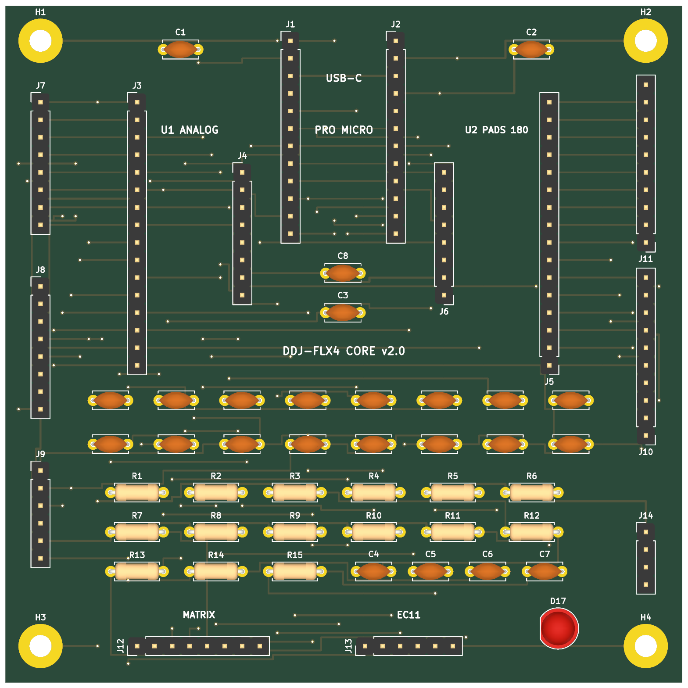
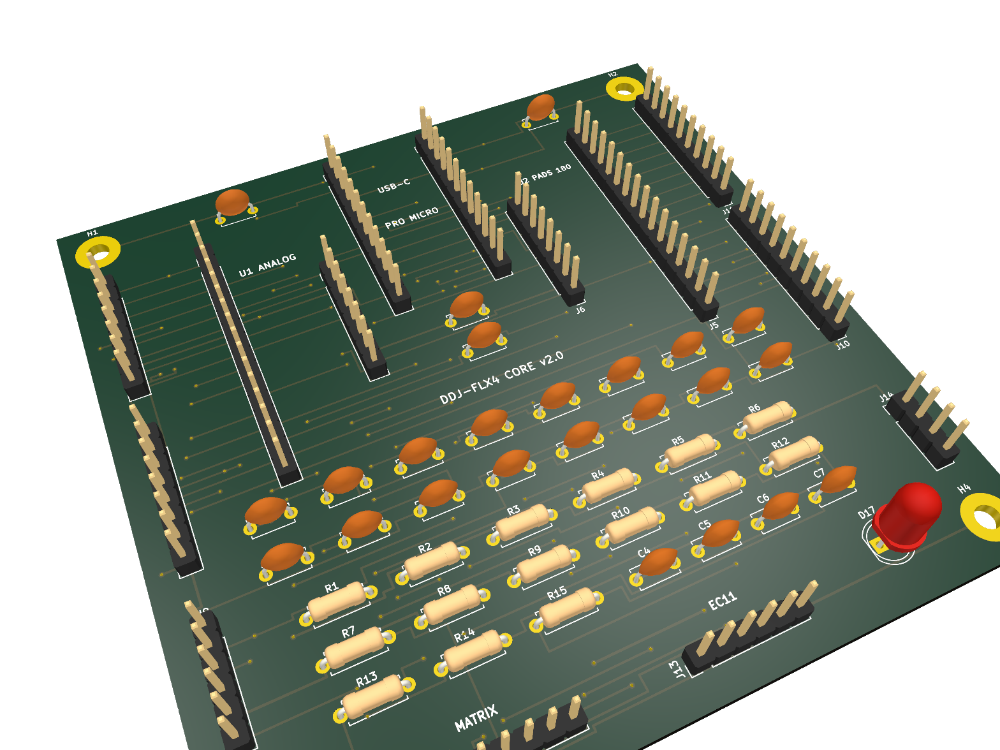

# Pioneer DDJ-FLX4 Modular Core v2.0 — Open-Source 2-Deck USB-MIDI DJ Controller

Hardware (**KiCad 9.0** `98 × 98 mm` 2-Layer Core PCB — **0 ERC / 0 DRC / 0 unconnected**, ~US\$ 2 na JLCPCB), chassi 3D imprimível em PLA (**FreeCAD 1.0** `.step`/`.stl` + **OpenSCAD** em 3 módulos `≤ 115 × 206 mm` que cabem em qualquer cama `220 × 220 mm`), e firmware USB-MIDI nativo (**ATmega32U4** com ISRs `PIND` atômicas, Pitch 14-bit e script JS para **Mixxx 2.4+**).

---

## 1. Visual Previews (v2.0)

### KiCad 9.0 3D Raytraced Core PCB (`98 × 98 mm`, 2-Layer FR4, Solid `B.Cu` GND Plane)

### FreeCAD 1.0 3D-Printable Enclosure Assembly (`340 × 206 × 48 mm`)

---

## 2. Arquitetura Modular Core v2.0 (Correções pós-Auditoria Red-Team)

1. **Placa-Mãe Central `98 × 98 mm`, 2 Camadas (`100% THT 2.54 mm`):**
   - **Arduino Pro Micro USB-C (`J1`/`J2`):** `RAW` (`J2.1`) e `RST` (`J2.3`) desconectados (`NC`), sem back-feed no LDO e sem reset em curto. Conector USB-C alinhado rente à parede traseira (`Y = 0`).
   - **2× Módulos Breakout `CD74HC4067` (`J3/J4` = `U1` Analógico; `J5/J6` = `U2` Pads rotacionado `180°`):** encaixe em barras fêmea `2.54 mm` (`15.24 mm` entre fileiras), sem solda SMD e sem cruzamento de barramento.
   - **Front-End Analógico Zero-Crosstalk:** `16×` capacitores `100 nF` (`C10..C25`) posicionados **ANTES** do multiplexador `U1` (um por canal `POT_CH0..15`), combinados com `R1 = 100 Ω` e `C3 = 1 nF` pós-mux ($\tau = 2.67\,\mu\text{s} \Rightarrow 0.00\%$ de crosstalk em $145\,\mu\text{s}$).
   - **Debounce de Encoders Padrão Alps (`ENC1`/`ENC2`):** `10 kΩ` pull-up (`R3..R6`) + `10 kΩ` resistor série limitador de corrente (`R12..R15`) + `10 nF` (`C4..C7`), protegendo os contatos contra *pitting*.
   - **Plano de Terra Sólido (`B.Cu`):** Copper Zone `GND` preenchida nativamente com thermal reliefs + espinha dorsal de retorno (`0` violações DRC, `0` itens desconectados).
   - **Conectores Perimetrais de Painel (`J7..J14`):** chicotes separados para Pots Deck A (`J7`), Pots Deck B (`J8`), Faders Mixer (`J9`), Pads Deck A (`J10`), Pads Deck B (`J11`), Matriz 4×4 (`J12`), Encoders EC11 (`J13`) e Alimentação Auxiliar (`J14`).
2. **Controles de Painel Montados na Faceplate 3D (`3.5 mm` PLA):**
   - `11×` potenciômetros rotativos `WH148 B10K` (passo `18.5 mm` > corpo `16 mm`, furos `Ø 7.6 mm` M7), `5×` slide faders **`D103 = D10K×2` (`75 mm` corpo / `60 mm` curso**, rasgos `4.6 × 64.0 mm` + furos `M2.5` a `71 mm`), `2×` encoders `EC11` (`Ø 7.6 mm` M7) e `30×` switches táteis `G82 12×12×5 mm` com keycaps `12.6 × 12.6 mm` em janelas `13.2 × 13.2 mm`.
3. **Chassi 3D Modular (`340 × 206 mm`) Compatível com Cama `220 × 220 mm`:**
   - Seccionado em `X = 115` e `X = 225 mm` $\rightarrow$ **Deck A (`115 × 206 mm`)**, **Mixer Central (`110 × 206 mm`)**, **Deck B (`115 × 206 mm`)**.
   - **12 pilares verticais M3** afastados `10 mm` das emendas com **bolsos sextavados para porcas M3 embutidas (*captive nuts* `5.8 mm` AF)** — zero rosca direta no PLA — além de flanges horizontais M3 travando as 3 seções.
   - **Jog Wheels (`Ø 84 mm`):** sem colisão com a faceplate, furo `Ø 6.25 mm` com chanfro D-flat + furo radial para parafuso travante `M3` (*set-screw*).
   - **Cupom de Calibração (`ddj_flx4_tolerance_test.stl`, `60 × 45 mm`, ~`8 g` PLA):** imprima primeiro (~15 min) para validar todas as folgas na sua impressora.
4. **Firmware USB-MIDI v2.0 + Mixxx 2.4+ (`firmware/`):**
   - Leitura atômica de `PIND` nas ISRs (`62.5 ns`, zero skew A/B).
   - Filtro EMA contínuo desacoplado da histerese de saída (alcança `0` e `127` limpos sem travamento).
   - **Pitch Faders 14-bit (`0xE0` / `0xE1` Pitch Bend):** resolução de `0.020 BPM` em `±8% @ 128 BPM` (8× mais fino que 7-bit CC).
   - Mapeamento completo para **Mixxx 2.4+** (`DDJ_FLX4_Arduino_MIDI.midi.xml` + `DDJ_FLX4_Arduino_MIDI.scripts.js` com suporte a Jog Wheel relativo e modo Scratch ao segurar `ENC1_SW`/`ENC2_SW`).

---

## 3. Bill of Materials (BOM v2.0)

### Na Placa-Mãe Central (`98 × 98 mm` — Upload `hardware/gerbers/ddj_flx4_core_v2_jlcpcb.zip` na JLCPCB)
| Designator | Qty | Componente | Observação |
| :--- | :---: | :--- | :--- |
| `J1`, `J2` | 1 | **Arduino Pro Micro USB-C (`ATmega32U4 5V 16MHz`)** + 2× barras fêmea `1×12` | Soquetado rente à borda traseira |
| `J3/J4`, `J5/J6` | 2 | **Módulo Breakout `CD74HC4067` (16-ch, 2.54mm THT)** + barras fêmea `1×16` & `1×8` | `U2` montado girado `180°` (ver serigrafia) |
| `J7..J14` | 8 | Barras de pinos `2.54 mm` (`3× 1×8`, `2× 1×10`, `2× 1×6`, `1× 1×4`) | Chicotes p/ controles de painel |
| `C10..C25`, `C1,C2,C8` | 19 | Capacitores cerâmicos **`100 nF (104)`** THT (`P5.0mm`) | 16× filtro pré-mux + 3× desacoplamento |
| `C3` | 1 | Capacitor cerâmico **`1 nF (102)`** THT (`P5.0mm`) | Anti-aliasing pós-mux (`0%` crosstalk) |
| `C4..C7` | 4 | Capacitores cerâmicos **`10 nF (103)`** THT (`P5.0mm`) | Debounce EC11 |
| `R2..R10`, `R12..R15` | 13 | Resistores **`10 kΩ`** 1/4W axial (`P7.62mm`) | Pull-ups + 4× série anti-pitting EC11 |
| `R1`, `R11` | 2 | `1× 100 Ω` (`R1` ADC) + `1× 330 Ω` (`R11` LED) | 1/4W axial |
| `D17` | 1 | LED `5 mm` Verde (Power) | Indicador de alimentação |

### No Painel 3D (Off-Board, ligados via chicote `24–26 AWG` a `J7..J14`)
| Designator | Qty | Componente |
| :--- | :---: | :--- |
| `RV1..RV10`, `RV16` | 11 | Potenciômetros rotativos **`WH148 B10K`** (`10 kΩ` linear) + knobs `6 mm` |
| `RV11..RV15` | 5 | Faders deslizantes **`D103 = D10K×2` (`75 mm` corpo / `60 mm` curso)** + tampas de fader + `10×` parafusos `M2.5` *(usar 1 canal; linearização LUT ativa no firmware)* |
| `SW1..SW30` | 30 | Switches táteis **`G82 12×12×5 mm`** |
| `ENC1`, `ENC2` | 2 | Encoders rotativos **`EC11`** com push-switch |
| `D1..D16` | 16 | Diodos **`1N4148`** (soldados nos terminais dos 14 botões + 2 switches EC11 da matriz 4×4) |
| Mecânica | 1 kit | `12× M3×35 mm` escareados + `4× M3×12 mm` (PCB) + `4× M3×16 mm` (emendas) + `2× M3×8 mm` (set-screw jogs) + `20× porcas M3` + `6× pezinhos de silicone` |

---

## 4. Ordem de Impressão 3D em PLA (~790 g total com suportes/brim)

1. **Primeiro (~8 g, 15 min):** Imprima `cad/stl/ddj_flx4_tolerance_test.stl` e teste fisicamente seu `WH148`, `EC11`, porca `M3`, fader e keycap.
2. **Base (3 módulos, todos cabem em `220 × 220 mm`):** `ddj_flx4_bottom_left_deckA.stl` (`115×206`), `ddj_flx4_bottom_center_mixer.stl` (`110×206`), `ddj_flx4_bottom_right_deckB.stl` (`115×206`).
3. **Faceplate (3 módulos, imprimir de cabeça para baixo na mesa para acabamento perfeito):** `ddj_flx4_top_left_deckA.stl`, `ddj_flx4_top_center_mixer.stl`, `ddj_flx4_top_right_deckB.stl`.
4. **Controles:** `2× ddj_flx4_jog_wheel.stl` (`0.16 mm` camada, `20%` gyroid) + `30× ddj_flx4_pad_keycap.stl`.
