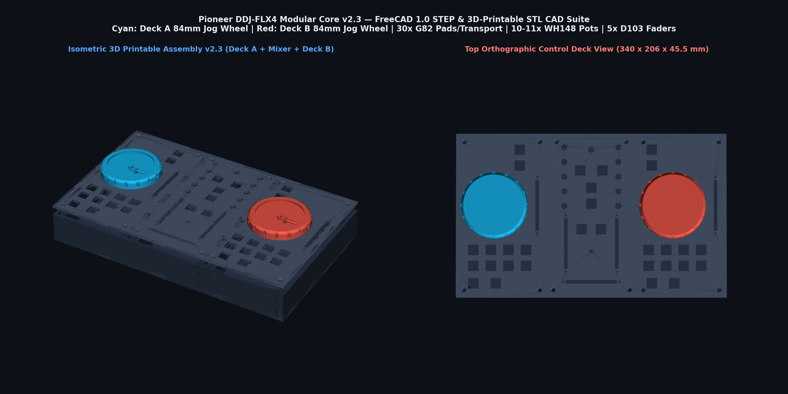

# Pioneer DDJ-FLX4 Modular Core v2.3 — Open-Source 2-Deck USB-MIDI DJ Controller

Hardware (**KiCad 9.0** `98 × 98 mm` 2-Layer Core PCB — **0 ERC / 0 DRC / 0 unconnected**, ~US\$ 2 na JLCPCB), chassi 3D imprimível em PLA (**FreeCAD 1.0** `.step`/`.stl` em 3 módulos `≤ 115 × 206 mm` compatíveis com cama `220 × 220 mm`, **0 colisões P0** após 3 rodadas independentes de auditoria), e firmware USB-MIDI nativo (**ATmega32U4** com ISRs `PIND` atômicas, varredura Gray, Pitch 14-bit e script JS para **Mixxx 2.4+**).

---

## 1. Visual Previews

### KiCad 9.0 3D Raytraced Core PCB (`98 × 98 mm`, 2-Layer FR4, Solid `B.Cu` GND Plane)

### FreeCAD 1.0 3D-Printable Enclosure Assembly (`340 × 206 × 45.5 mm`)

---

## 2. Arquitetura Modular Core v2.3 (Consolidada após 3 Rodadas de Auditoria)

1. **Placa-Mãe Central `98 × 98 mm`, 2 Camadas (`100% THT 2.54 mm`):**
   - **Arduino Pro Micro USB-C (`J1`/`J2`):** `RAW` (`J2.1`) e `RST` (`J2.3`) desconectados (`NC`).
   - **2× Módulos Breakout Azuis `CD74HC4067` (`J3/J4` = `U1` Analógico com `C15` no topo; `J5/J6` = `U2` Pads girado `180°` com `C0` no topo):** casados 1:1 com o módulo azul físico (`1×16` `C15..C0` + `1×8` `SIG, S3, S2, S1, S0, EN, VCC, GND` alinhado a `C11..C4`, passo `15.24 mm`). *Fazer teste de continuidade A1 antes de subir o Gerber.*
   - **Front-End Analógico Baixo-Crosstalk:** `16×` capacitores `100 nF` (`C10..C25`) **ANTES** do multiplexador `U1` + `R1 = 100 Ω` com **`C3 = DNP`** (não montar `C3`, mantendo o resíduo de carga em `0.22–0.37 LSB` em vez de `3.6–6.2 LSB`).
   - **Debounce de Encoders Padrão Alps (`ENC1`/`ENC2`):** `10 kΩ` pull-up (`R3..R6`) + `10 kΩ` série anti-pitting (`R12..R15`) + `10 nF` (`C4..C7`), compatível com os limiares LVTTL reais do ATmega32U4 ($V_{IL} \le 0.90\text{ V}$, $V_{IH} \ge 1.90\text{ V}$).
   - **Plano de Terra Sólido (`B.Cu`):** `0` violações DRC, `0` itens desconectados (`hardware/gerbers/ddj_flx4_core_v2_jlcpcb.zip`).
2. **Chassi 3D Modular v2.3 (`340 × 206 × 45.5 mm`, `BOTTOM_H = 42 mm`) — 0 Colisões P0:**
   - **PCB recuada `0.5 mm` da parede traseira (`PCB_Y_REAR = 201.5 mm`):** furos traseiros `H1/H2` (`126.08, 196.42` / `213.71, 196.42`) usam **`M3×12` cabeça cilíndrica por baixo** + **espaçador de latão F-F `M3×30` (`5.5 AF`)** + boss `Ø 7 × 1.4 mm` sob a faceplate (`M3×10` escareado por cima). Tirar a tampa não solta a PCB e mantém `+0.71..+1.21 mm` de folga até `RV1/RV6`.
   - **Lábio (`WALL_T + 0.5 mm`) e nervuras de emenda com alívio `Ø 11 mm`** nos 10 pilares + `H1/H2`.
   - **Recorte USB-C alinhado em `Z = -25.2 .. -9.2 mm`** (acomoda overmold até `8.5 mm`).
   - **6 Carriers rígidos com orelhas (`ddj_flx4_switch_carriers.stl`):** `deckA_frente`, `deckB_frente`, `mixer_top`, `mixer_cue`, `loopsync_A`, `loopsync_B`, base `±8.2 mm` (parede sólida por fora dos rasgos de pinos `±7.15 mm`), todos os 30 switches dentro da envoltória convexa de apoio (`margem ≥ +1.0 mm`, alcance `≤ 14.9 mm`), empacotamento automático sem sobreposição, `CARRIER_STANDOFF_H = 4.5 mm` (ajustar para `5.6 mm` se o atuador `G82` medir `≥ Ø 7.2 mm`).
   - **Jog Wheels (`Ø 84 mm`) + Faceplate cheia (`3.5 mm`, sem rebaixo `Ø 86`):** trava de porca `M3` em `r = 6.8..9.2 mm` (livre do rebaixo sob o cubo `Ø 12.5 × 4.0 mm`), canal de acesso `Ø 3.4 mm` para **grub `M3×8`**.
   - **Emendas:** blocos até `Z = -3.0 mm` apoiando as nervuras da faceplate + **4× `M3×12` horizontais por emenda** (`Y = 28` em `Z = -8, -34`; `Y = 178` em `Z = -8, -20` — livres da PCB, de `J9/J10` e de `loopsync_B`).
3. **Firmware USB-MIDI v2.3 + Mixxx 2.4+ (`firmware/`):**
   - Varredura do mux em **código Gray cíclico** (`{0,1,3,2,6,7,5,4,12,13,15,14,10,11,9,8}` — sempre 1 bit por troca entre `PD4/PC6/PD7/PE6`).
   - **`#define HAS_RV16 0`:** pula *apenas* o bloco analógico de `U1` no canal `15` (mantém `SW16` / Pad 8 Deck B e a sequência Gray intactos; nunca usar jumper em `POT_CH15`).
   - **Matriz 4×4 em Open-Drain:** linhas inativas em `INPUT` (Hi-Z), eliminando risco de curto `> 40 mA` caso um diodo `1N4148` fique invertido.
   - **Histerese aplicada sobre o `filtered` cru antes da LUT**, linearização nos **5 faders `D103`** (`CH10..CH14`), zona morta central no Pitch 14-bit (`0xE0`/`0xE1`), `beatloop_toggle` e `SMART_CFX`/`BEAT_FX` nos 2 decks no Mixxx.

---

## 3. Checklist de Bancada (Antes de Fabricar / Imprimir)

| # | Medição física | Objetivo |
|---|---|---|
| **A1** | Módulo azul `CD74HC4067`: encaixe a seco (componentes p/ cima, `1×16` à esquerda, USB-C longe de você $\rightarrow$ canto superior = `C15` alinhado a `SIG`) + continuidade `GND↔pino 12`, `C0↔9`, `C15↔16` e passo `15.24 mm` | **P0** — Libera `ddj_flx4_core_v2_jlcpcb.zip` na JLCPCB |
| **A2** | Diâmetro do atuador do switch `G82` | `CARRIER_STANDOFF_H = 4.5 mm` (`< Ø 7.2`) ou `5.6 mm` (`≥ Ø 7.2`) |
| **A3** | Altura do `WH148` + fio soldado abaixo da faceplate + diâmetro real do corpo (`r ≤ 8.5 mm`) | Folga em Z = `0.8 mm` (se `> 16 mm`, dobrar terminais ou usar `BOTTOM_H = 44`) |
| **A4** | `EC11`: comprimento da bucha M7, comprimento do eixo (`15` vs `20 mm`) e trecho D-flat | Confirmar `JOG_Z` e cota `Z = 4.5 mm` do grub `M3×8` |
| **A5** | Medir fader `D103` no multímetro a `0 / 25 / 50 / 75 / 100%` | Ajustar `LOG_INV_LUT` (ou desligar `LINEARIZE_D103_LOG_FADERS` se linear) |

---

## 4. Bill of Materials (BOM v2.3)

### Na Placa-Mãe Central (`98 × 98 mm` — `hardware/gerbers/ddj_flx4_core_v2_jlcpcb.zip`)
| Designator | Qty | Componente | Observação |
| :--- | :---: | :--- | :--- |
| `J1`, `J2` | 1 | **Arduino Pro Micro USB-C (`ATmega32U4 5V 16MHz`)** + 2× barras fêmea `1×12` | Soquetado rente à borda traseira |
| `J3/J4`, `J5/J6` | 2 | **Módulo Breakout `CD74HC4067` (16-ch, 2.54mm THT)** + barras fêmea `1×16` & `1×8` | `U2` montado girado `180°` |
| `J7..J14` | 8 | Barras de pinos `2.54 mm` (`3× 1×8`, `2× 1×10`, `2× 1×6`, `1× 1×4`) | Chicotes p/ controles de painel |
| `C10..C25`, `C1,C2,C8` | 19 | Capacitores cerâmicos **`100 nF (104)`** THT (`P5.0mm`) | 16× filtro pré-mux + 3× desacoplamento |
| `C3` | 0 | **`DNP` (Não montar)** | Deixar vazio p/ evitar compartilhamento de carga |
| `C4..C7` | 4 | Capacitores cerâmicos **`10 nF (103)`** THT (`P5.0mm`) | Debounce EC11 |
| `R2..R10`, `R12..R15` | 13 | Resistores **`10 kΩ`** 1/4W axial (`P7.62mm`) | Pull-ups + 4× série anti-pitting EC11 |
| `R1`, `R11` | 2 | `1× 100 Ω` (`R1` ADC) + `1× 330 Ω` (`R11` LED) | 1/4W axial |
| `D17` | 1 | LED `5 mm` Verde (Power) | Opcional: puxar com 2 fios p/ furo da faceplate |

### No Painel 3D (Off-Board) e Ferragens M3 (v2.3)
| Designator | Qty | Componente |
| :--- | :---: | :--- |
| `RV1..RV10` (+ `RV16` opc.) | 10–11 | Potenciômetros rotativos **`WH148 B10K`** (`10 kΩ` linear) + knobs `6 mm` (`HAS_RV16 = 0` se usar 10) |
| `RV11..RV15` | 5 | Faders deslizantes **`D103 = D10K×2` (`75 mm` / `60 mm` curso)** + tampas + `10×` parafusos `M2.5` |
| `SW1..SW30` | 30 | Switches táteis **`G82 12×12×5 mm`** |
| `ENC1`, `ENC2` | 2 | Encoders rotativos **`EC11`** (preferir sem detent) com push-switch |
| `D1..D16` | 16 | Diodos **`1N4148`** (matriz 4×4 anti-ghosting) |
| **Ferragens M3 (v2.3)** | 1 kit | `10× M3×45` escareados (pilares) + `2× M3×12` cabeça cilíndrica + `2×` espaçador latão F-F `M3×30` (`5.5 AF`) + `2× M3×10` escareados (H1/H2) + `2× M3×10` (H3/H4 PCB) + `40× M3×6` (6 carriers) + `2×` grub `M3×8` + `2×` porcas `M3` (jogs) + `8× M3×12` + `8×` porcas + `16×` arruelas (emendas) + `12×` porcas `M3` (pilares/H3/H4) + `6×` pezinhos de silicone |

---

## 5. Ordem de Impressão 3D em PLA

1. **Primeiro (~8 g, 15 min):** `cad/stl/ddj_flx4_tolerance_test.stl` (validar folgas da impressora).
2. **Base (`42 mm`, 3 módulos `≤ 115 × 206 mm`):** `ddj_flx4_bottom_left_deckA.stl`, `ddj_flx4_bottom_center_mixer.stl`, `ddj_flx4_bottom_right_deckB.stl`.
3. **Faceplate (3 módulos, imprimir de cabeça para baixo):** `ddj_flx4_top_left_deckA.stl`, `ddj_flx4_top_center_mixer.stl`, `ddj_flx4_top_right_deckB.stl`.
4. **Carriers dos 30 Switches `G82` (6 placas com orelhas em 1 mesa):** `cad/stl/ddj_flx4_switch_carriers.stl`.
5. **Controles:** `2× ddj_flx4_jog_wheel.stl` + `30× ddj_flx4_pad_keycap.stl`.
